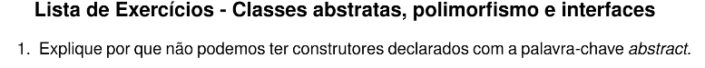

# QUESTÃO 01 - LISTA III

Resposta:

Não podemos ter construtores `abstract` por que os construtores não são herdados pelas subclasses, enquanto o modificador `abstract` exige obrigatoriamente que o elemento seja sobrescrito/implementado por uma classe filha.

Além disso, o objetivo de um construtor é inicializar uma instância concreta e alocar o seu estado; Se um construtor pudesse ser abstrato (sem corpo), seria impossível construir qualquer objeto a partir da hierarquia de herança.